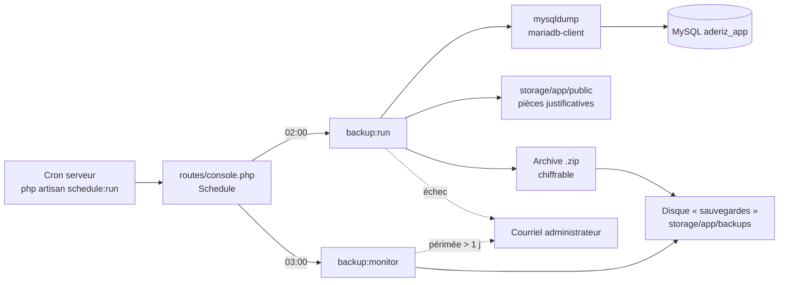
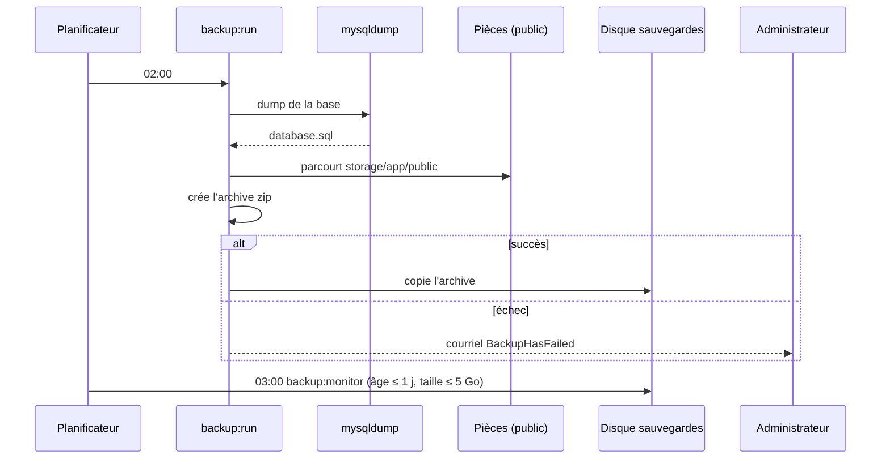
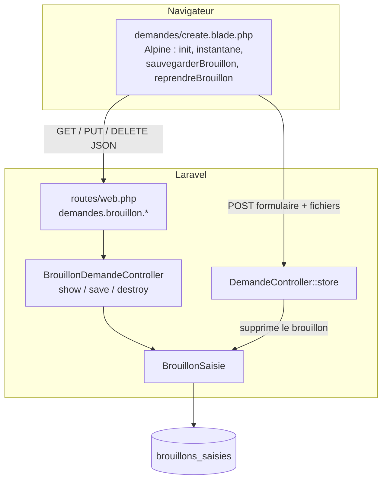
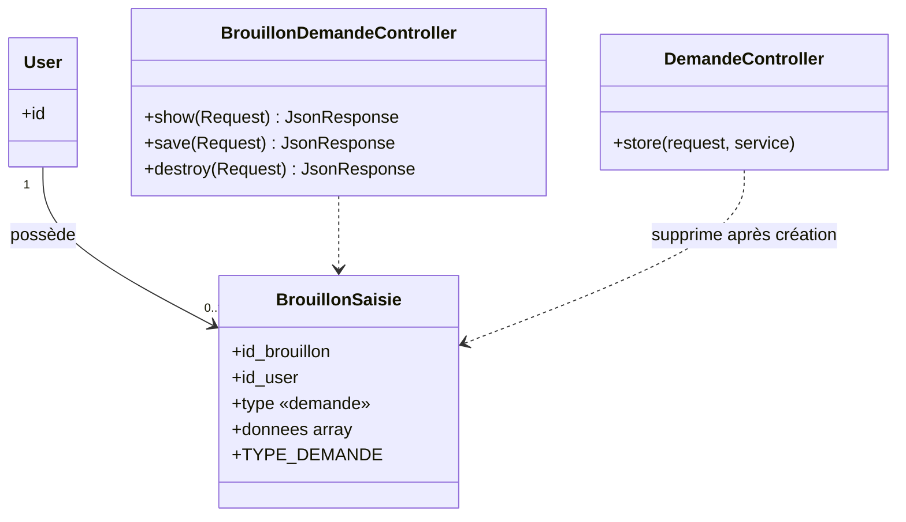
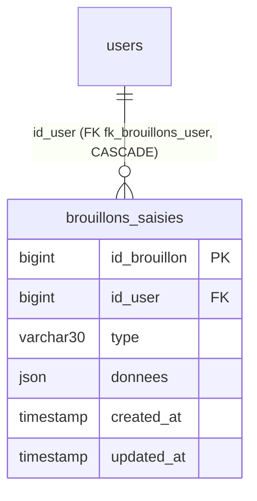
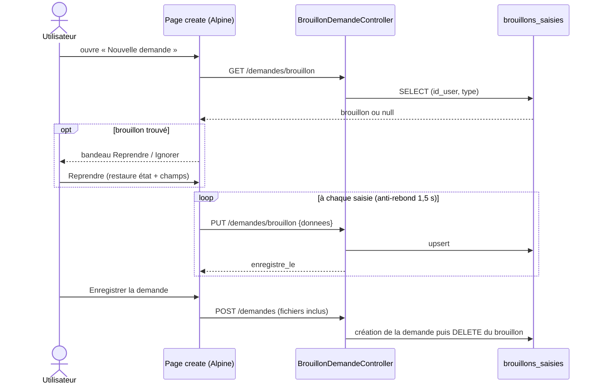

# Sauvegarde des données et brouillon de saisie

Deux mécanismes distincts : la **sauvegarde système** (SNF05, serveur) et le **brouillon de saisie** (formulaire de demande).
Les schémas sont en Mermaid (rendus par GitHub, GitLab, VS Code, etc.).

## 1. Architecture — sauvegarde système

Configuration : `config/backup.php` (contenu, disque, rétention, notifications), disque dans `config/filesystems.php`,
`mariadb-client` dans `infra/Dockerfile`. Variables : `BACKUP_DISKS`, `BACKUP_ARCHIVE_PASSWORD`, `BACKUP_NOTIFY_MAIL`, `DB_DUMP_EXTRA_OPTION`.

### Séquence d'une sauvegarde

> Aucun nettoyage automatique : `backup:clean` n'est pas planifié, toutes les archives sont conservées.
> `backup:monitor` prévient quand les archives dépassent 5 Go ; supprimer alors les plus anciennes à la main.

## 2. Brouillon de saisie

### Composants

### Classes

### MLD

Contrainte `uq_brouillons_user_type` : un seul brouillon par utilisateur et par type de formulaire (extensible à d'autres formulaires).

### Séquence

Limites : les fichiers téléversés ne sont pas conservés (à rejoindre après reprise) ; seule la création de demande est couverte
(pas l'édition ni la saisie en série) ; taille maximale 100 000 octets.
